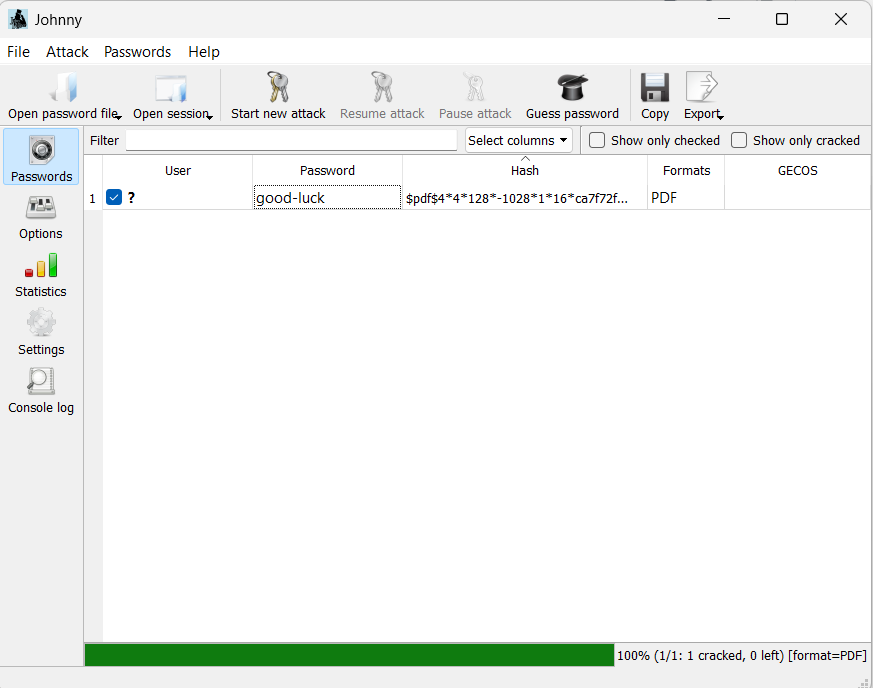
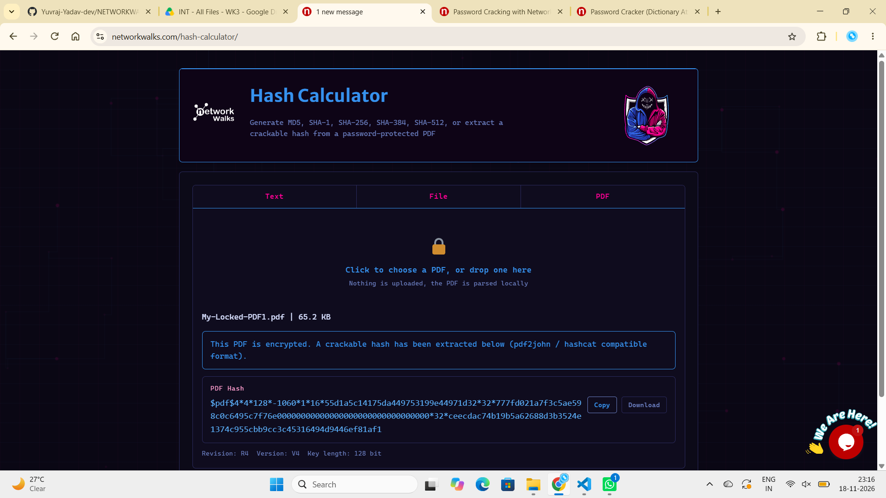
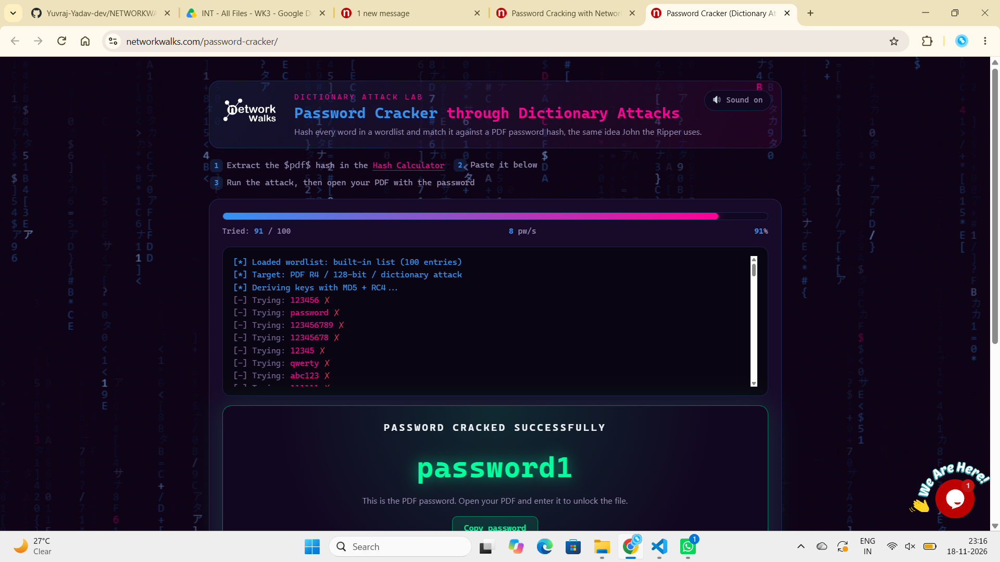
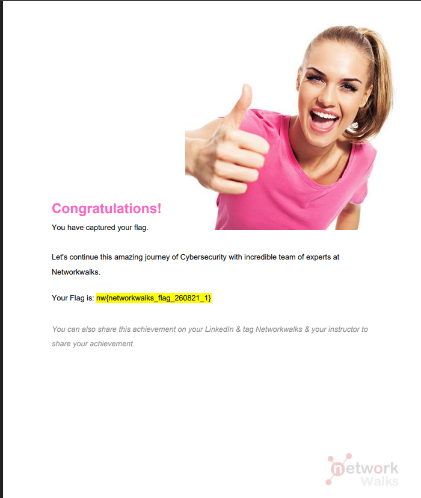
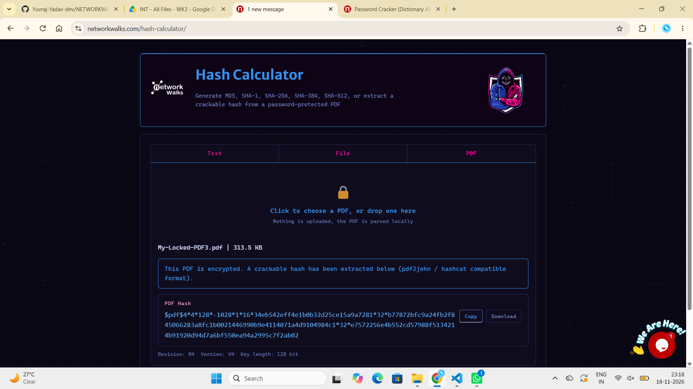
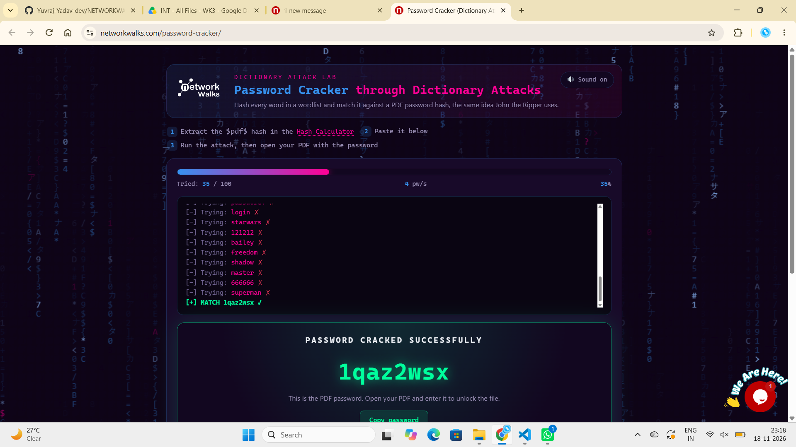

# Networkwalks CyberSecurity Internship - Week 3

# Password Cracking Project

This repository documents two password-cracking lab exercises completed
as part of the Networkwalks Cybersecurity & Ethical Hacking internship.

## Modules
1. **Module 1 – Password Cracking with JTR (John the Ripper / Johnny GUI)**
2. **Module 2 – Password Cracking with Networkwalks Online Tools (Hash Calculator + Password Cracker)**

## Tools Used
- John the Ripper (JTR) + Johnny GUI
- Networkwalks Hash Calculator – https://networkwalks.com/hash-calculator/
- Networkwalks Password Cracker – https://networkwalks.com/password-cracker/
- Adobe Acrobat Reader DC (to verify cracked password opens the PDF)

## Disclaimer
All PDFs cracked in this exercise were provided by Networkwalks specifically
for training purposes as part of the internship curriculum. No unauthorized
or third-party files were tested.

---

## Module 1: Password Cracking with JTR (John the Ripper / Johnny)

### Task
Crack the password of the attached PDF file (`My Locked PDF1.pdf`) using
JTR JOHN and JTR JOHNNY tools on a Windows PC.

### Steps Performed
1. Downloaded and installed John the Ripper + Johnny GUI on Windows.
2. Pointed Johnny to `john.exe` inside the `run` folder via Settings → Browse.
3. Extracted the PDF's hash using an online hash extraction tool.
4. Saved the hash into a text file and opened it in Johnny via "Open password file".
5. Clicked "Start new attack".
6. **Result: password cracked = `good-luck`**
7. Opened the PDF with Adobe Acrobat Reader DC using the cracked password → file unlocked.

### Cracked Password
good-luck

### Flag Captured

nw{networkwalks_persistence_jtr_270521}

---

## Module 2: Password Cracking with Networkwalks Tools

### Task
Crack the password of the attached PDF file (`My Locked PDF1.pdf`) using the
Networkwalks Hash Calculator and Password Cracker tools, fully browser-based,
no installation required.

### Steps Performed
1. Opened the Networkwalks Hash Calculator and uploaded the locked PDF (PDF tab).
2. The tool extracted a crackable hash from the encrypted file.

3. Copied the extracted hash and pasted it into the Networkwalks Password Cracker.
4. Ran the built-in dictionary attack (100-word list).

5. **Result: password cracked = `password1`**
6. Opened the PDF, entered `password1`, file unlocked successfully.

### Cracked Password
password1

### Flag Captured

nw{cybersecurity_flag_captured_2608}

---

## Additional Practice Run (Networkwalks Tools)

### Task
Repeated the Hash Calculator + Password Cracker workflow on a second sample
PDF file to reinforce the dictionary-attack concept.

### Steps Performed
1. Uploaded the second locked PDF to the Hash Calculator and extracted the hash.

2. Pasted the hash into the Password Cracker and ran the dictionary attack.

3. **Result: password cracked = `1qaz2wsx`**
4. Opened the PDF with the cracked password → file unlocked.

### Cracked Password

1qaz2wsx
---

## Flags Summary

| Module                          | Tool Used                          | Cracked Password | Flag                                  |
|----------------------------------|--------------------------------------|-------------------|-----------------------------------------|
| Module 1 – JTR / Johnny          | John the Ripper + Johnny             | good-luck         | nw{networkwalks_persistence_jtr_270521} |
| Module 2 – Networkwalks Tools    | Hash Calculator + Password Cracker   | password1         | nw{cybersecurity_flag_captured_2608}    |

## Key Learnings

- Understood how password-protected PDF files use encryption mechanisms and how password hashes can be extracted for security testing.
- Learned the practical workflow of using John the Ripper (JTR) and Johnny GUI to perform dictionary-based password attacks on extracted PDF hashes.
- Gained experience with browser-based password-cracking utilities and understood how they simplify hash analysis without requiring additional software installation.
- Observed how dictionary attacks use predefined wordlists to identify weak passwords by testing possible combinations against the extracted hash.
- Successfully recovered passwords from multiple sample PDFs, demonstrating how predictable passwords and common keyboard patterns can make files vulnerable to dictionary attacks.
- Compared two password-cracking approaches: an installation-based tool (JTR/Johnny) and online utilities, understanding their different workflows and practical use cases.
- Reinforced the importance of creating strong, unique passwords to reduce the risk of successful dictionary-based attacks.

### Overall Outcome

Successfully completed the PDF password-cracking exercises using both GUI-based and browser-based tools, gaining hands-on experience with hash extraction, dictionary attacks, and password security concepts.